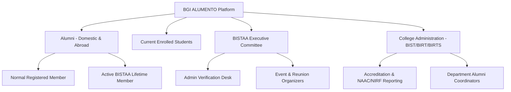
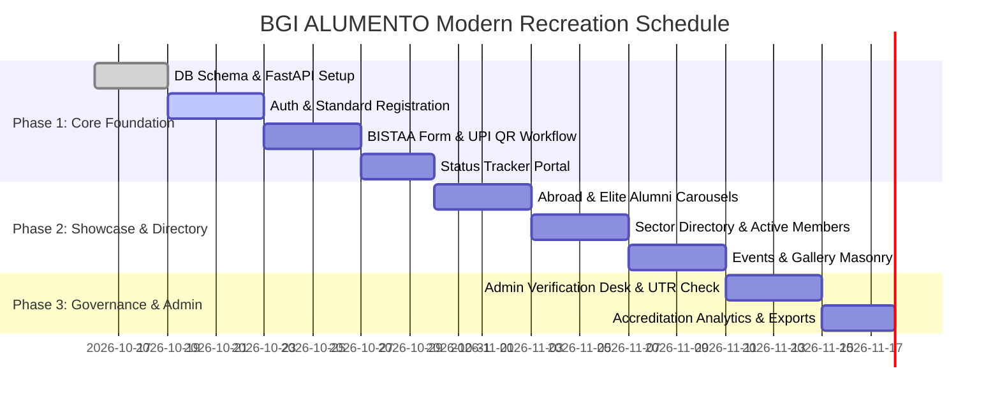

# Product Requirements Document (PRD)

> **Implementation status:** This document describes the product vision and requirements; it is not a guarantee that every requirement is implemented. The repository now includes a React frontend and FastAPI service connected to the supplied MariaDB schema for core alumni, membership, event, gallery, and review workflows. External payment processing and email delivery are not included.

## BGI ALUMENTO: Bansal Group of Institutions (BIST) Modern Alumni Platform
### Comprehensive Modernization & Recreation of `bistalumni.in`

---

### Document Control
- **Product Name:** BGI ALUMENTO (BISTAA Modern Alumni Platform)
- **Target Legacy Site:** `https://bistalumni.in/` (Bansal Institute of Science and Technology, Bhopal)
- **Stakeholder Institutions:** BIST, BIRT, BIRTS (Bansal Group of Institutions - BGI)
- **Document Version:** 2.0.0 (Tailored Recreation)
- **Status:** Approved for Implementation
- **Architecture Baseline:** React (Vite) + TypeScript + Tailwind CSS + Python (FastAPI) + PostgreSQL

---

### 1. Executive Summary & Transformation Vision

#### 1.1 Legacy System Analysis (`bistalumni.in`)
The current `bistalumni.in` website is built with legacy procedural PHP, Bootstrap 4, jQuery, and MySQL. While it provides essential community touchpoints, it suffers from several major architectural and UX shortcomings:
- **Disjointed User Journeys:** Separate, disconnected forms for "Normal Registration" (`signup`), "BISTAA Registration" (`bistaa_form.php`), and "Status Check" (`bistaa_status.php`).
- **Manual Verification Bottlenecks:** Manual visual checks of uploaded UPI payment screenshots without cryptographic validation or automated transaction reconciliation.
- **Static Showcases:** Hardcoded lists for "Abroad Alumni" and "Elite Alumni" without dynamic search, filtering, or geolocation mapping.
- **Security Vulnerabilities:** Direct parameter passing, insecure admin modals triggered by front-end radio buttons, and lack of token-based authentication (JWT).

#### 1.2 Modern Platform Vision
The modernized BGI ALUMENTO platform recreates and expands the core essence of `bistalumni.in` into an ultra-fast, responsive, secure web platform using **React (Vite)** on the frontend, **Python (FastAPI)** on the backend, and **PostgreSQL** for storage.

Key strategic enhancements:
1. **Unified Identity & BISTAA Association Membership:** Seamless two-stage onboarding (Normal Registered Alumnus -> Active BISTAA Lifetime Member) with live UPI QR payment integration, receipt generator, and transparent status tracking.
2. **Interactive Global & Domestic Alumni Explorer:** Transforming the static "Abroad Alumni" and "Elite Alumni" into an interactive geospatial map and searchable directory categorized by employment sector (Government, Private, Semi-Government, Entrepreneur).
3. **Comprehensive Institution Coverage:** Native support for all BGI constituent colleges (**BIST**, **BIRT**, **BIRTS**) and degree programs (B.Tech, MBA, MCA, M.Tech across CSE, IT, ME, EC, Civil, EE).
4. **Modern Events & Gallery Hub:** High-performance media galleries and reunion RSVPs with digital QR passes.

---

### 2. Stakeholders & User Personas

#### Persona 1: Abroad / Elite Alumnus
- **Profile:** A verified alumnus profile populated from the connected alumni database.
- **Needs:** Connect with alma mater, inspire students via guest lectures, offer referrals, and participate in global chapter meetups.

#### Persona 2: Domestic Graduate / BISTAA Applicant
- **Profile:** Neha Sharma (BIST CSE 2021, Software Engineer in Bengaluru)
- **Needs:** Register for BISTAA membership (₹300 fee), track membership approval status, connect with peers in private and government sectors.

#### Persona 3: Current Student (Junior)
- **Profile:** Amit Patel (3rd Year CSE, BIST Bhopal)
- **Needs:** Explore alumni working at dream companies (Amazon, Infosys, Walmart, Google), request career guidance, and find alumni-referred internships.

#### Persona 4: BISTAA Administrator / Faculty Coordinator
- **Profile:** Prof. R. K. Sharma (BIST Alumni Association Coordinator)
- **Needs:** Search enrollment records, verify 12-digit UPI transaction IDs and payment slips, activate members, post official events, and manage the photo gallery.

---

### 3. Core Functional Modules & Requirements

#### 3.1 Module 1: Two-Tier Registration & BISTAA Association Membership
- **PRD-FR-1.1 (Standard Alumni Registration):**
  - Capture comprehensive graduate details:
    - First Name, Last Name, Gender
    - Enrollment Number (e.g., `0112CS181045` with automatic college and branch regex parsing)
    - Native State & Native City/Place
    - College Selection: **BIST**, **BIRT**, **BIRTS**
    - Passout Year (Batch)
    - Degree & Branch: Computer Science (CSE), Information Technology (IT), Electronics & Comm (ECE), Electrical (EE), Mechanical (ME), Civil, MBA, MCA
    - Working Sector: **Government**, **Semi-Government**, **Private**, **Self-Employed / Entrepreneur**
    - Current Employer / Organization, Position / Job Title
    - Company Location (India vs. Abroad) & Specific City/Country
    - Profile Photo Upload & Social Links (LinkedIn, Twitter, Portfolio)
    - Email & Mobile Phone Number
- **PRD-FR-1.2 (BISTAA Lifetime Membership Registration):**
  - Recreates `bistaa_form.php` with modern UX:
  - Dynamic enrollment number auto-complete against registered records.
  - Fixed lifetime membership fee (₹300 INR).
  - Dynamic UPI QR Code display (supports BHIM, Google Pay, PhonePe, Paytm).
  - 12-digit UPI Transaction Reference Number (UTR) input with strict validation regex `^\d{12}$`.
  - Transaction slip/screenshot upload with image optimization and preview.
- **PRD-FR-1.3 (Public Registration Status Tracker):**
  - Recreates `bistaa_status.php` as a modern real-time tracking portal:
  - Search by Enrollment Number or Phone Number.
  - Visual status progress stepper: `Submitted` -> `Payment Under Review` -> `Activated as BISTAA Active Member` -> `Digital ID Card Issued`.
  - Downloadable PDF digital membership receipt / badge upon activation.

#### 3.2 Module 2: Alumni Directory & Sector-Based Discovery
- **PRD-FR-2.1 (Sector-Wise Categorization):**
  - Faithful recreation of `bistalumni.in` sectors:
    1. **Government Sector** (ISRO, BHEL, Railways, Public Works, Civil Services)
    2. **Semi-Government / PSU Sector** (IOCL, NTPC, ONGC, State Utilities)
    3. **Private Sector** (TCS, Infosys, Amazon, Microsoft, Walmart, L&T)
    4. **Entrepreneurs & Self-Employed** (Founders, Consultants, Agency Owners)
- **PRD-FR-2.2 (Abroad & Elite Alumni Spotlight):**
  - Dedicated interactive spotlight sections for:
    - **Abroad Alumni Showcase:** Displaying alumni placed across USA, UK, Canada, Germany, UAE, etc., with interactive country pins.
    - **Elite Alumni Grid:** Star alumni in managerial, executive, and public roles.
- **PRD-FR-2.3 (BISTAA Active Members Directory):**
  - Exclusive directory view of verified active members with badge indicators, batch filters, and direct connection requests.

#### 3.3 Module 3: Events, Reunions & Institutional Gallery
- **PRD-FR-3.1 (Upcoming & Past Events):**
  - BIST Alumni Meets, Annual Reunions, Silver Jubilee celebrations, Expert Talks.
  - Interactive event cards with dates, physical venue / virtual Google Meet links, registration buttons, and attendee lists.
- **PRD-FR-3.2 (Digital Event Passes & Check-in):**
  - Attendees receive digital event QR passes for streamlined check-in at campus gates.
- **PRD-FR-3.3 (Photo & Video Gallery):**
  - Recreates `gallery` with responsive masonry layout, categorization (Reunions, Campus Life, Award Ceremonies), and high-resolution lightbox view.

#### 3.4 Module 4: Admin & BISTAA Association Management Console
- **PRD-FR-5.1 (Verification Desk):**
  - Secure admin interface replacing legacy plaintext password popups.
  - View applicant details side-by-side with submitted UPI transaction slip and 12-digit UTR.
  - Actions: **Activate Member**, **Reject with Reason**, **Flag Duplicate UTR**.
- **PRD-FR-5.2 (Bulk Ingestion & Export):**
  - CSV export for institutional accreditation (NAAC, NBA, NIRF alumni placement data).
  - Bulk student master record upload for pre-populating enrollment lists.

---

### 4. Technical Architecture Overview

| Layer | Modern Framework Selection |
| :--- | :--- |
| **Frontend Web App** | React 18+ (Vite SPA) + TypeScript + Tailwind CSS |
| **Icons & Media** | Lucide React + Swiper.js / Embla Carousel for hero & abroad alumni |
| **Backend REST API** | Python 3.11+ (FastAPI) + Pydantic v2 + Uvicorn |
| **Database & ORM** | PostgreSQL 16 + SQLAlchemy 2.0 (Async) + Alembic |
| **File Storage** | Local / S3-compatible storage for transaction slips and avatars |
| **Authentication** | JWT Access & Refresh Tokens + Argon2 password hashing |

---

### 5. Implementation Roadmap

