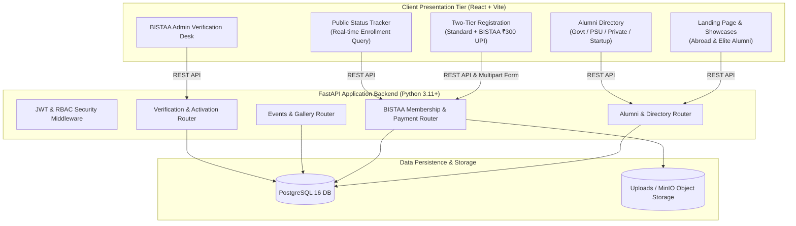
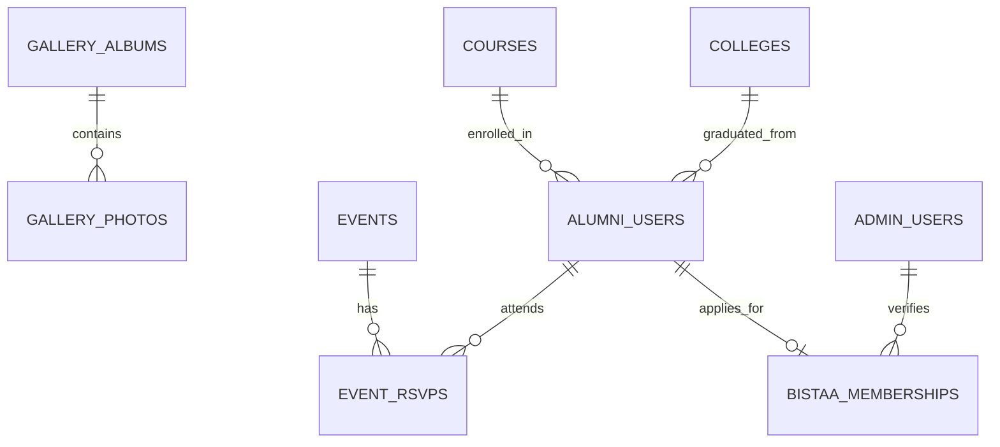

# Software Requirements Specification (SRS)

> **Implementation status:** This document describes requirements and planned architecture; it is not a guarantee that every requirement is implemented. The repository now includes a React frontend and FastAPI service connected to the supplied MariaDB schema for core alumni, membership, event, gallery, and review workflows. External payment processing and email delivery are not included.

## BGI ALUMENTO: Modern Alumni Management System
### Modernized Engineering Specification for `bistalumni.in` (Bansal Group of Institutions)

**Specification Standard:** IEEE Std 830-1998 Format  
**Version:** 2.0.0 (Tailored Recreation)  
**Date:** October 2026  
**Status:** Approved for Implementation  
**Target Legacy Site:** `https://bistalumni.in/` (BIST / BIRT / BIRTS - Bhopal)  

---

### 1. Introduction

#### 1.1 Purpose
This Software Requirements Specification (SRS) defines the functional, interface, performance, and security requirements for rebuilding and modernizing the **BGI ALUMENTO** alumni platform (`bistalumni.in`). The system transforms the legacy PHP/MySQL implementation into a decoupled, high-performance web platform leveraging a **React 18+ (Vite)** Single Page Application, a **Python (FastAPI)** REST API backend, and a **PostgreSQL 16** relational database.

#### 1.2 Scope of Modernization
The modernized application encompasses:
- Institutional support across **BIST** (Bansal Institute of Science & Technology), **BIRT** (Bansal Institute of Research & Technology), and **BIRTS** (Bansal Institute of Research, Technology & Science).
- Two-tier registration: **Standard Alumni Registration** and **BISTAA (Alumni Association) Membership** (₹300 lifetime fee with UPI QR scan and 12-digit UTR validation).
- Public **Registration Status Portal** with real-time tracking by Enrollment Number.
- High-visibility showcases: **Abroad Alumni Spotlight**, **Elite Alumni Showcase**, and **Upcoming Events**.
- Filterable **Alumni Directory** classified by employment sector:
  - Government Sector
  - Semi-Government / PSU Sector
  - Private Sector
  - Self-Employed / Entrepreneur
- Dedicated **BISTAA Active Members Directory**.
- Interactive **Photo/Video Gallery** with categorized albums.
- Secure **Admin Verification Console** with side-by-side slip verification, eliminating the legacy system's insecure front-end authentication modals.

---

### 2. Overall Description & Operating Environment

#### 2.1 System Architecture

#### 2.2 User Classes & Roles
1. **Unregistered Visitor / Public:** Can browse landing page, abroad/elite alumni showcases, upcoming events, and public gallery.
2. **Standard Alumnus:** Registered graduate of BIST/BIRT/BIRTS. Listed in general alumni directory.
3. **BISTAA Applicant (Pending Payment Verification):** Alumnus who submitted the ₹300 association fee and 12-digit UPI UTR. Awaiting admin approval.
4. **BISTAA Active Member (Vista Member):** Approved lifetime alumni association member with a verified badge, access to the exclusive directory, and voting rights.
5. **Department Coordinator / Admin:** Faculty coordinator who verifies alumni from their respective branches.
6. **Super Administrator (BISTAA Admin):** Institutional head managing master graduation records, event publishing, slip approvals, and system configuration.

---

### 3. Detailed Functional Requirements

#### Module 1: Standard Alumni Registration (`/register`)
- **SRS-FR-01.1 (Standard Registration Form):**
  - The system SHALL present a comprehensive registration form with validation for:
    - `firstname`: Text, mandatory, max 100 characters.
    - `lastname`: Text, mandatory, max 100 characters.
    - `enroll_no`: Text, mandatory, unique, alphanumeric format (e.g., `0112CS181045` or `0112IT...`).
    - `gender`: Dropdown selection (`Male`, `Female`, `Other`).
    - `navstate`: Native State dropdown containing all 28 Indian States and 8 Union Territories.
    - `native`: Native Place / City text input.
    - `college`: Dropdown selection strictly from: `BIST`, `BIRT`, `BIRTS`.
    - `batch`: Graduation / Passout year (YYYY format).
    - `course_id`: Dropdown selection from: `Civil Engg`, `Computer Science Engg.`, `Electrical Engg.`, `Electronic & Communication`, `Information Technology`, `Mechanical Engg.`, `MBA`, `MCA`.
    - `companysector`: Dropdown selection: `Government`, `Semi-Government`, `Private`, `Self Employed`.
    - `connected_to`: Current organization / employer / business name.
    - `pos`: Current designation / position.
    - `comploc`: Working location category (`INDIA` or `ABROAD`).
    - `companyloc`: Current city / country of residence.
    - `img`: Profile photo upload (JPEG, PNG, WebP; max 5MB).
    - `email`: Valid email address, unique constraint.
    - `phone_no`: Valid 10-digit Indian mobile number.
    - `linkedinid`: Social media / LinkedIn profile URL.
    - `password`: Hashed password for user portal login.
- **SRS-FR-01.2 (Enrollment Parsing):**
  - The system SHALL automatically infer the branch (e.g., `CS` -> Computer Science, `IT` -> Information Technology, `ME` -> Mechanical) from the enrollment number regex pattern to expedite form completion.

#### Module 2: BISTAA Association Membership & UPI Workflow (`/bistaa-membership`)
- **SRS-FR-02.1 (Enrollment Autocomplete & Pre-fill):**
  - The system SHALL expose an endpoint `GET /api/v1/bistaa/lookup?enroll={query}` returning matching registered alumni.
  - When an enrollment number is selected, the system SHALL auto-populate `name`, `branch`, and `college`.
  - IF the enrollment number is not found in the standard alumni directory, the system SHALL prompt: *"Please complete Normal Registration first."*
- **SRS-FR-02.2 (Membership Fee & UPI QR Engine):**
  - The system SHALL display the fixed membership fee: **₹300/-**.
  - The system SHALL dynamically generate a UPI intent QR code (`upi://pay?pa=...&pn=BISTAA&am=300&cu=INR&tn=BISTAA_Membership_{enroll_no}`) for mobile scanning.
- **SRS-FR-02.3 (UTR & Transaction Slip Capture):**
  - The system SHALL accept a **12-digit numeric UPI Transaction ID (UTR)** validated by regex `^\d{12}$`.
  - The system SHALL enforce uniqueness on `upi_transaction_id` to prevent duplicate payment submissions.
  - The system SHALL require uploading the transaction screenshot (`transaction_slip`), securely storing it and associating it with the application.
  - Upon submission, the record status SHALL transition to `PENDING_VERIFICATION`.

#### Module 3: Real-Time BISTAA Registration Status Tracker (`/status`)
- **SRS-FR-03.1 (Public Status Inquiry):**
  - The system SHALL allow users to query registration status via `GET /api/v1/bistaa/status/{enroll_no}`.
- **SRS-FR-03.2 (Visual Progress Stepper):**
  - The system SHALL render a visual timeline showing:
    1. **Application Submitted** (with submission timestamp)
    2. **Payment Slip Under Review** (with UTR preview)
    3. **Approved as BISTAA Active Member** (or Rejected with reason)
    4. **Digital Membership Card Active**
- **SRS-FR-03.3 (Membership Details Display):**
  - The portal SHALL display submitted Enrollment Number, Name, Branch, College, Amount (₹300), Transaction ID, and a secure preview modal of the uploaded slip.

#### Module 4: High-Visibility Showcases & Directory
- **SRS-FR-04.1 (Abroad Alumni Spotlight):**
  - The landing page SHALL feature an interactive carousel and world map highlighting graduates placed outside India (e.g. Amazon Seattle, Walmart USA, Vodafone UK, Brock University Canada).
  - Cards SHALL display Alumnus Photo, Name, Organization, Degree Branch, and Passout Year.
- **SRS-FR-04.2 (Elite Alumni Showcase):**
  - The system SHALL display prominent leaders and executives (e.g. Tata Projects, L&T Defense, Google, Infosys).
- **SRS-FR-04.3 (Sector-Based Directory):**
  - The directory SHALL provide quick-filter tabs matching legacy categorizations:
    - All Alumni
    - Government Sector
    - Semi-Government / PSU Sector
    - Private Sector
    - Self Employed / Entrepreneur
  - Filters SHALL support Batch Year range, College (BIST/BIRT/BIRTS), and Branch.
- **SRS-FR-04.4 (BISTAA Active Members Directory):**
  - A dedicated view showcasing verified lifetime association members with verified badges and membership IDs.

#### Module 5: Events & Campus Gallery
- **SRS-FR-05.1 (Event Listings & Detail):**
  - Display upcoming and past alumni meets, annual reunions, and webinars.
  - Event details SHALL include banner, date/time, venue / virtual link, description, and an RSVP mechanism.
- **SRS-FR-05.2 (Categorized Gallery):**
  - Responsive image grid with lightbox view categorized into: Reunions, Convocation, Campus Nostalgia, and Guest Lectures.

#### Module 6: Admin Verification & Activation Console (`/admin`)
- **SRS-FR-06.1 (Secure Admin Portal):**
  - Access restricted to authenticated administrators via JWT session (eliminating legacy front-end password prompts).
- **SRS-FR-06.2 (Review & Activation Queue):**
  - Admin view displaying pending BISTAA applications with applicant data, 12-digit UTR, and high-resolution slip preview.
  - One-click action: **"Activate as BISTAA Member"** which:
    - Sets `is_bistaa_active = TRUE`.
    - Generates a unique BISTAA Membership ID (e.g. `BISTAA-2026-0842`).
    - Dispatches an automated confirmation email to the alumnus.
  - Rejection action with custom rejection note (e.g. "Invalid UTR or screenshot unreadable").

---

### 4. Database Schema & Data Dictionary

#### Key Database Tables

1. **`colleges`**: `code` (PK: BIST, BIRT, BIRTS), `full_name`, `city`.
2. **`courses`**: `id` (PK), `name` (CSE, IT, ME, EC, EE, Civil, MBA, MCA), `degree` (B.Tech, M.Tech, MBA, MCA).
3. **`alumni_users`**:
   - `id`: UUID (PK)
   - `enroll_no`: VARCHAR(32) (UNIQUE, indexed)
   - `firstname`: VARCHAR(100), `lastname`: VARCHAR(100)
   - `gender`: VARCHAR(16)
   - `native_state`: VARCHAR(64), `native_place`: VARCHAR(128)
   - `college_code`: VARCHAR(16) (FK -> colleges.code)
   - `passout_year`: INT (indexed)
   - `course_id`: INT (FK -> courses.id)
   - `working_sector`: VARCHAR(32) (Government, Semi-Government, Private, Self Employed)
   - `company_name`: VARCHAR(255)
   - `position`: VARCHAR(255)
   - `location_type`: VARCHAR(16) (INDIA, ABROAD)
   - `current_location`: VARCHAR(255)
   - `avatar_url`: TEXT
   - `email`: VARCHAR(255) (UNIQUE)
   - `phone_no`: VARCHAR(32)
   - `linkedin_url`: TEXT
   - `is_abroad_spotlight`: BOOLEAN DEFAULT FALSE
   - `is_elite_spotlight`: BOOLEAN DEFAULT FALSE
   - `is_bistaa_member`: BOOLEAN DEFAULT FALSE
   - `created_at`: TIMESTAMPTZ DEFAULT NOW()

4. **`bistaa_memberships`**:
   - `id`: UUID (PK)
   - `alumni_id`: UUID (FK -> alumni_users.id, UNIQUE)
   - `enrollment_number`: VARCHAR(32) (indexed)
   - `membership_fee`: NUMERIC(10,2) DEFAULT 300.00
   - `upi_transaction_id`: VARCHAR(12) (UNIQUE, indexed)
   - `transaction_slip_url`: TEXT NOT NULL
   - `status`: VARCHAR(32) (PENDING_VERIFICATION, ACTIVE, REJECTED)
   - `rejection_reason`: TEXT
   - `membership_id`: VARCHAR(64) (UNIQUE)
   - `verified_by_admin_id`: UUID
   - `verified_at`: TIMESTAMPTZ
   - `submitted_at`: TIMESTAMPTZ DEFAULT NOW()

5. **`events`**: `id`, `title`, `description`, `event_date`, `venue`, `banner_url`, `is_active`.
6. **`gallery_photos`**: `id`, `title`, `category`, `image_url`, `event_id`, `created_at`.

---

### 5. Non-Functional Requirements (NFR)

- **Performance:** Directory search and status check queries SHALL respond within **< 100ms** at the 95th percentile.
- **Security:**
  - Passwords hashed via **Argon2id**.
  - All admin endpoints guarded with **JWT tokens** carrying role claims (`ROLE_ADMIN`, `ROLE_SUPERADMIN`).
  - Transaction slip uploads strictly checked for MIME type (`image/jpeg`, `image/png`, `image/webp`) and scanned for malformed payloads.
- **Mobile First Design:** All pages fully optimized for mobile devices (375px viewport) since over 70% of alumni access registration and UPI scan via smartphones.
- **Reliability:** Automated database backups with point-in-time recovery to safeguard institutional records.
