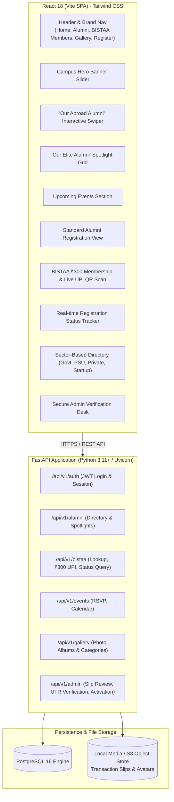
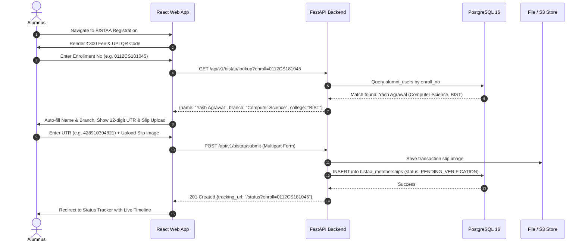

# System Architecture & Technical Design Document (design.md)
## BGI ALUMENTO: Modern Alumni Platform for Bansal Group of Institutions (BIST)
### Architecture & Technical Specification for Recreating `bistalumni.in`

---

### Document Control
- **System:** BGI ALUMENTO (Modern BISTAA Platform)
- **Reference Legacy Implementation:** `https://bistalumni.in/`
- **Constituent Colleges:** BIST, BIRT, BIRTS (Bhopal, Madhya Pradesh)
- **Frameworks:** React 18+ (Vite) + TypeScript + Tailwind CSS + Python 3.11+ (FastAPI) + PostgreSQL 16
- **Version:** 2.0.0
- **Status:** Approved Baseline Architecture

---

### 1. Architectural Overview & Component Structure

#### 1.1 Decoupled System Architecture
The platform is re-engineered from legacy monolithic PHP into a modern decoupled architecture:



---

### 2. Complete PostgreSQL Schema DDL (`schema.sql`)

```sql
-- Enable necessary extensions
CREATE EXTENSION IF NOT EXISTS "uuid-ossp";
CREATE EXTENSION IF NOT EXISTS "pgcrypto";
CREATE EXTENSION IF NOT EXISTS "pg_trgm";

-- ENUMS
CREATE TYPE college_enum AS ENUM ('BIST', 'BIRT', 'BIRTS');
CREATE TYPE working_sector_enum AS ENUM ('Government', 'Semi-Government', 'Private', 'Self Employed');
CREATE TYPE location_type_enum AS ENUM ('INDIA', 'ABROAD');
CREATE TYPE bistaa_status_enum AS ENUM ('PENDING_VERIFICATION', 'ACTIVE', 'REJECTED');
CREATE TYPE gender_enum AS ENUM ('Male', 'Female', 'Other');

-- 1. COURSES & DEPARTMENTS TABLE
CREATE TABLE courses (
    id SERIAL PRIMARY KEY,
    name VARCHAR(128) NOT NULL,
    short_code VARCHAR(32) NOT NULL UNIQUE,
    degree VARCHAR(64) NOT NULL
);

INSERT INTO courses (name, short_code, degree) VALUES
('Computer Science Engg.', 'CSE', 'B.Tech'),
('Information Technology', 'IT', 'B.Tech'),
('Electronic & Communication', 'ECE', 'B.Tech'),
('Electrical Engg.', 'EE', 'B.Tech'),
('Mechanical Engg.', 'ME', 'B.Tech'),
('Civil Engg', 'CE', 'B.Tech'),
('Master of Business Administration', 'MBA', 'MBA'),
('Master of Computer Applications', 'MCA', 'MCA');

-- 2. ALUMNI USERS TABLE (Standard Registration from signup.php)
CREATE TABLE alumni_users (
    id UUID PRIMARY KEY DEFAULT uuid_generate_v4(),
    enroll_no VARCHAR(32) UNIQUE NOT NULL,
    firstname VARCHAR(100) NOT NULL,
    lastname VARCHAR(100) NOT NULL,
    gender gender_enum NOT NULL,
    native_state VARCHAR(64) NOT NULL,
    native_place VARCHAR(128) NOT NULL,
    college college_enum NOT NULL DEFAULT 'BIST',
    batch INT NOT NULL, -- Passout Year
    course_id INT NOT NULL REFERENCES courses(id) ON DELETE RESTRICT,
    companysector working_sector_enum NOT NULL,
    connected_to VARCHAR(255) NOT NULL, -- Current Company / Organization
    pos VARCHAR(255) NOT NULL, -- Job Position / Designation
    comploc location_type_enum NOT NULL DEFAULT 'INDIA',
    companyloc VARCHAR(255) NOT NULL, -- City / Country
    img_url TEXT, -- Profile image path
    email VARCHAR(255) UNIQUE NOT NULL,
    phone_no VARCHAR(32) NOT NULL,
    linkedinid TEXT,
    password_hash VARCHAR(255),
    is_abroad_spotlight BOOLEAN DEFAULT FALSE,
    is_elite_spotlight BOOLEAN DEFAULT FALSE,
    is_bistaa_member BOOLEAN DEFAULT FALSE,
    created_at TIMESTAMPTZ NOT NULL DEFAULT NOW(),
    updated_at TIMESTAMPTZ NOT NULL DEFAULT NOW()
);

-- Indices for high-speed directory queries & lookups
CREATE INDEX idx_alumni_enroll ON alumni_users(enroll_no);
CREATE INDEX idx_alumni_college ON alumni_users(college);
CREATE INDEX idx_alumni_batch ON alumni_users(batch);
CREATE INDEX idx_alumni_sector ON alumni_users(companysector);
CREATE INDEX idx_alumni_comploc ON alumni_users(comploc);
CREATE INDEX idx_alumni_name_trgm ON alumni_users USING gin ((firstname || ' ' || lastname) gin_trgm_ops);

-- 3. BISTAA MEMBERSHIPS TABLE (Recreating bistaa_form.php & bistaa_status.php)
CREATE TABLE bistaa_memberships (
    id UUID PRIMARY KEY DEFAULT uuid_generate_v4(),
    alumni_id UUID NOT NULL REFERENCES alumni_users(id) ON DELETE CASCADE,
    enrollment_number VARCHAR(32) NOT NULL,
    name VARCHAR(255) NOT NULL,
    branch VARCHAR(128) NOT NULL,
    membership_amount NUMERIC(10,2) NOT NULL DEFAULT 300.00,
    upi_transaction_id VARCHAR(12) NOT NULL UNIQUE, -- Strict 12-digit UPI UTR
    transaction_slip_url TEXT NOT NULL,
    status bistaa_status_enum NOT NULL DEFAULT 'PENDING_VERIFICATION',
    membership_id VARCHAR(64) UNIQUE, -- Generated on activation e.g. BISTAA-2026-0042
    rejection_reason TEXT,
    verified_by VARCHAR(128),
    verified_at TIMESTAMPTZ,
    submitted_at TIMESTAMPTZ NOT NULL DEFAULT NOW()
);

CREATE INDEX idx_bistaa_enroll ON bistaa_memberships(enrollment_number);
CREATE INDEX idx_bistaa_status ON bistaa_memberships(status);
CREATE INDEX idx_bistaa_upi ON bistaa_memberships(upi_transaction_id);

-- 4. EVENTS TABLE (Recreating view_event & upcoming events)
CREATE TABLE events (
    id UUID PRIMARY KEY DEFAULT uuid_generate_v4(),
    title VARCHAR(255) NOT NULL,
    description TEXT NOT NULL,
    event_date TIMESTAMPTZ NOT NULL,
    venue VARCHAR(255) NOT NULL,
    banner_url TEXT,
    is_published BOOLEAN DEFAULT TRUE,
    created_at TIMESTAMPTZ DEFAULT NOW()
);

CREATE TABLE event_rsvps (
    id UUID PRIMARY KEY DEFAULT uuid_generate_v4(),
    event_id UUID REFERENCES events(id) ON DELETE CASCADE,
    alumni_id UUID REFERENCES alumni_users(id) ON DELETE CASCADE,
    status VARCHAR(32) DEFAULT 'ATTENDING',
    registered_at TIMESTAMPTZ DEFAULT NOW(),
    UNIQUE(event_id, alumni_id)
);

-- 5. GALLERY TABLE (Recreating gallery.php)
CREATE TABLE gallery_albums (
    id SERIAL PRIMARY KEY,
    title VARCHAR(128) NOT NULL,
    category VARCHAR(64) NOT NULL DEFAULT 'General'
);

CREATE TABLE gallery_photos (
    id UUID PRIMARY KEY DEFAULT uuid_generate_v4(),
    album_id INT REFERENCES gallery_albums(id) ON DELETE CASCADE,
    title VARCHAR(255),
    image_url TEXT NOT NULL,
    uploaded_at TIMESTAMPTZ DEFAULT NOW()
);

-- 6. ADMIN USERS TABLE
CREATE TABLE admin_users (
    id UUID PRIMARY KEY DEFAULT uuid_generate_v4(),
    username VARCHAR(64) UNIQUE NOT NULL,
    email VARCHAR(255) UNIQUE NOT NULL,
    password_hash VARCHAR(255) NOT NULL,
    role VARCHAR(32) DEFAULT 'ADMIN', -- ADMIN, SUPER_ADMIN
    created_at TIMESTAMPTZ DEFAULT NOW()
);
```

---

### 3. API Design & Endpoint Contracts (FastAPI)



#### API Specification

| Endpoint | Method | Role / Access | Purpose |
| :--- | :---: | :---: | :--- |
| `/api/v1/alumni/register` | `POST` | Public | Standard Alumni Registration (`signup.php` recreation). |
| `/api/v1/alumni/list` | `GET` | Public | Filtered directory with `sector` (`Government`, `Private`, `Semi-Government`, `Self Employed`), `college`, and `batch`. |
| `/api/v1/alumni/abroad` | `GET` | Public | List of alumni working abroad for the interactive world map & spotlight slider. |
| `/api/v1/alumni/elite` | `GET` | Public | List of executive/prominent alumni for the Elite Showcase grid. |
| `/api/v1/alumni/bistaa-active`| `GET` | Public | Directory of verified active BISTAA association members. |
| `/api/v1/bistaa/lookup` | `GET` | Public | Real-time autocomplete lookup by Enrollment Number for the BISTAA membership form. |
| `/api/v1/bistaa/submit` | `POST` | Public | Submit ₹300 BISTAA membership with 12-digit UTR and screenshot upload. |
| `/api/v1/bistaa/status/{enroll_no}` | `GET` | Public | Public status check endpoint for the Status Tracker timeline. |
| `/api/v1/events` | `GET` | Public | List of upcoming and past campus reunions and events. |
| `/api/v1/events/{id}/rsvp` | `POST` | Authenticated | Register RSVP attendance for an event. |
| `/api/v1/gallery` | `GET` | Public | List of campus photo albums and categorized pictures. |
| `/api/v1/admin/login` | `POST` | Public | Authenticate administrator and receive secure JWT token. |
| `/api/v1/admin/bistaa/pending`| `GET` | Admin | Review pending BISTAA applications with slip image URLs and UTR numbers. |
| `/api/v1/admin/bistaa/{id}/activate` | `POST` | Admin | Approve payment, mark alumnus as BISTAA Active Member, and issue membership ID. |
| `/api/v1/admin/bistaa/{id}/reject` | `POST` | Admin | Reject membership with formal explanation note. |

---

### 4. UI/UX Design System & Theme Specification

#### 4.1 Color System (BGI Academic Heritage)
- **Primary Brand Navy:**
  - `bgi-navy-900`: `#002244` (Deep Academic Base)
  - `bgi-navy-800`: `#003366` (Primary Brand Color)
  - `bgi-navy-700`: `#004080` (Header / Nav gradient from bistalumni.in)
  - `bgi-navy-600`: `#005cb9` (Accent Gradient Blue)
- **Secondary / Accent Palette:**
  - `bgi-gold`: `#F59E0B` (Royal Amber / Elite Alumni Badges)
  - `bgi-emerald`: `#10B981` (Verified Active BISTAA Badge & Success Alerts)
  - `bgi-crimson`: `#EF4444` (Required Star, Error Alerts)
- **Neutral Backgrounds:**
  - `bgi-canvas`: `#EEF2F7` (Matching bistalumni.in's light slate background)
  - `bgi-card`: `#FFFFFF` with soft shadows (`box-shadow: 0 8px 25px rgba(0,0,0,0.08)`)

#### 4.2 Typography Scale
- **Headings (Brand & Titles):** `Plus Jakarta Sans` or `Outfit` (Bold, 600-800 weight)
- **Body & Form Controls:** `Inter` (Regular 400, Medium 500)
- **Mono Identifiers:** `JetBrains Mono` for Enrollment Numbers (`0112CS...`) and 12-digit UPI UTRs

---

### 5. Frontend Component Architecture (React + Vite)

```
alumni-web/
├── src/
│   ├── components/
│   │   ├── common/
│   │   │   ├── Badge.tsx           # Sector & Verification Badges
│   │   │   ├── Modal.tsx           # Reusable Image & Dialog Modal
│   │   │   └── Toast.tsx           # Modern Alert Toasts
│   │   ├── layout/
│   │   │   ├── Navbar.tsx          # BGI ALUMENTO Header with Responsive Nav
│   │   │   └── Footer.tsx          # Stakeholder info, contact, and social links
│   │   ├── home/
│   │   │   ├── HeroSlider.tsx      # Campus Convocation & Banner Carousel
│   │   │   ├── AbroadAlumniSwiper.tsx # "Our Abroad Alumni" Cards Carousel
│   │   │   ├── EliteAlumniGrid.tsx # "Our Elite Alumni" Showcase
│   │   │   └── UpcomingEventsSection.tsx # Event Cards with Preview
│   │   ├── bistaa/
│   │   │   ├── BistaaForm.tsx      # ₹300 Membership, UPI QR & UTR input
│   │   │   ├── StatusStepper.tsx   # Visual status timeline (Submitted -> Verified)
│   │   │   └── MembershipCard.tsx  # Downloadable Digital Member Pass
│   │   ├── directory/
│   │   │   ├── SectorTabs.tsx      # Govt / Semi-Govt / Private / Self-Employed
│   │   │   ├── AlumniCard.tsx      # Alumnus Card with Avatar, Company & Position
│   │   │   └── DirectoryFilters.tsx# College (BIST/BIRT/BIRTS), Batch, Branch
│   │   └── admin/
│   │       ├── VerificationQueue.tsx# Side-by-side slip viewer & 1-click activation
│   │       └── StatCounters.tsx    # Total alumni, verified count, total fees
│   ├── pages/
│   │   ├── HomePage.tsx
│   │   ├── AlumniDirectoryPage.tsx
│   │   ├── ActiveMembersPage.tsx
│   │   ├── GalleryPage.tsx
│   │   ├── NormalRegistrationPage.tsx
│   │   ├── BistaaRegistrationPage.tsx
│   │   ├── StatusTrackerPage.tsx
│   │   └── AdminDashboardPage.tsx
│   ├── api/                        # Axios HTTP client with API services
│   └── types/                      # TypeScript schemas matching DB models
```

---

### 6. Blueprint: Recreated Key Pages & Wireframes

#### 6.1 BISTAA Membership Form (`bistaa_form.php` Modernized)
```
+---------------------------------------------------------------------------------------+
|  [BGI ALUMENTO]   Home  |  Alumni  |  Active Members  |  Gallery  |  [Register v]    |
+---------------------------------------------------------------------------------------+
|                                                                                       |
|  Bansal Institute of Science & Technology, Bhopal - BISTAA Membership Registration    |
|                                                                                       |
|  +-------------------------------------------+  +-----------------------------------+ |
|  | LEFT: Alumni Verification Details         |  | RIGHT: Scan & Pay UPI QR Code     | |
|  | ---------------------------------         |  | -----------------------------     | |
|  | Enrollment Number *                       |  |  +-----------------------------+  | |
|  | [ 0112CS181045                      ]     |  |  |     [ DYNAMIC UPI QR ]      |  | |
|  | (Auto-detected: Yash Agrawal - CSE BIST)  |  |  |   Scan with GPay/PhonePe    |  | |
|  |                                           |  |  +-----------------------------+  | |
|  | Alumnus Full Name                         |  |                                   | |
|  | [ Yash Agrawal                   (Lock) ] |  |  Lifetime Membership Fee: ₹300/-  | |
|  |                                           |  |                                   | |
|  | Branch & College                          |  |  [Step 1] Scan QR & Pay ₹300      | |
|  | [ Computer Science Engg. - BIST  (Lock) ] |  |  [Step 2] Note 12-Digit UPI UTR   | |
|  |                                           |  |  [Step 3] Upload Screenshot Slip  | |
|  | 12-Digit UPI Transaction ID (UTR) *       |  +-----------------------------------+ |
|  | [ 428910394821                          ] |                                        |
|  |                                           |                                        |
|  | Upload Payment Screenshot Slip *          |                                        |
|  | [ Choose File: upi_slip.jpg             ] |                                        |
|  +-------------------------------------------+                                        |
|                                                                                       |
|                      [ SUBMIT BISTAA MEMBERSHIP APPLICATION ]                         |
+---------------------------------------------------------------------------------------+
```

#### 6.2 Public Registration Status Tracker (`bistaa_status.php` Modernized)
```
+---------------------------------------------------------------------------------------+
|  Track Your BISTAA Registration Status                                                |
|  [ Enter Enrollment Number: 0112CS181045                   ] [ Track Status Button ] |
|                                                                                       |
|  Status Progress Timeline:                                                            |
|  (✔) Application Submitted ----> (✔) Payment Verified ----> (★) BISTAA Active Member  |
|                                                                                       |
|  Registration Summary:                                                                |
|  - Enrollment No:    0112CS181045                                                     |
|  - Alumnus Name:     Yash Agrawal                                                     |
|  - College & Branch: BIST | Computer Science Engg. (Batch of 2015)                     |
|  - Membership Fee:   ₹300.00 [PAID]                                                   |
|  - UPI UTR No:       428910394821                                                     |
|  - Status:           ACTIVE BISTAA LIFETIME MEMBER (ID: BISTAA-2015-0812)             |
|  - Transaction Slip: [ Thumbnail Preview (Click to Zoom) ]                            |
|                                                                                       |
|  [ Download Digital BISTAA Identity Card PDF ]                                        |
+---------------------------------------------------------------------------------------+
```
